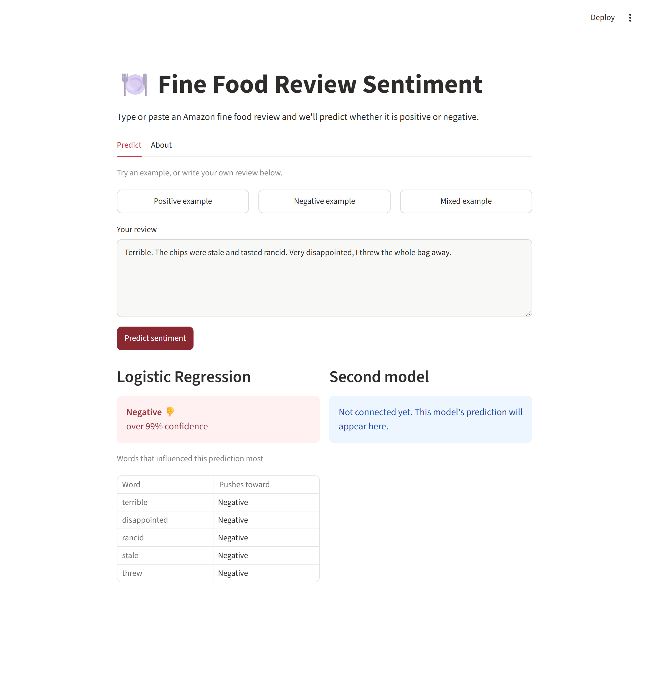
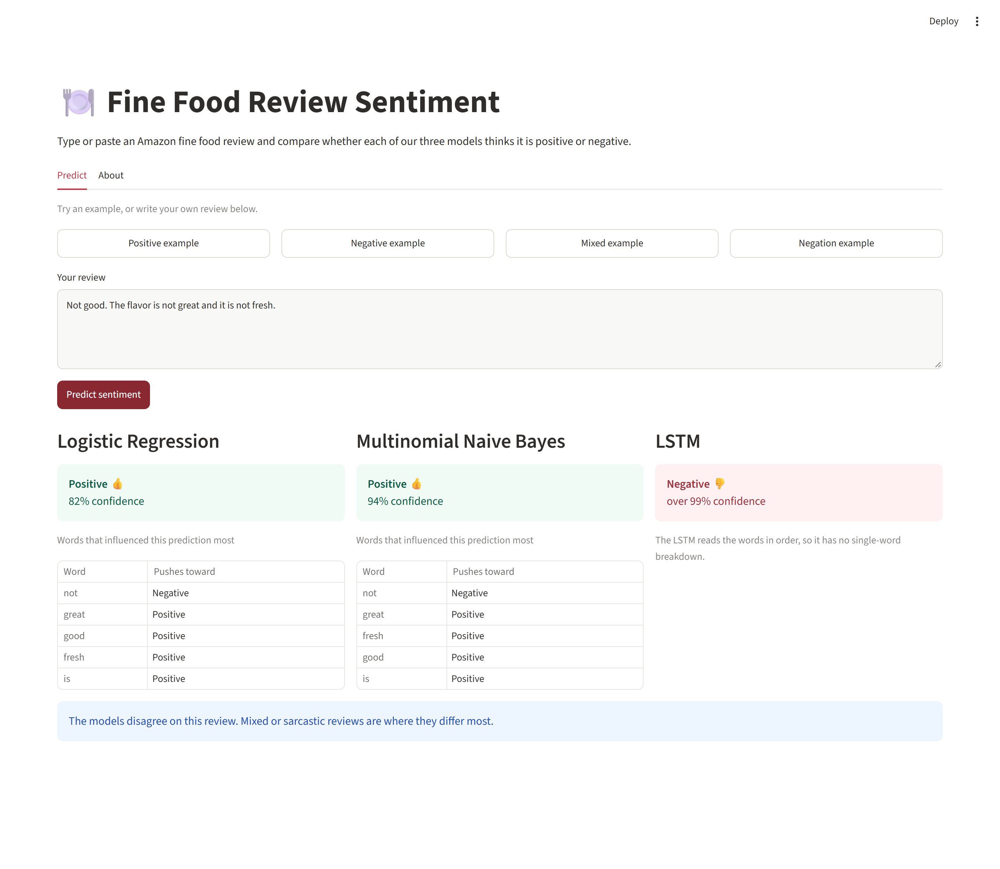
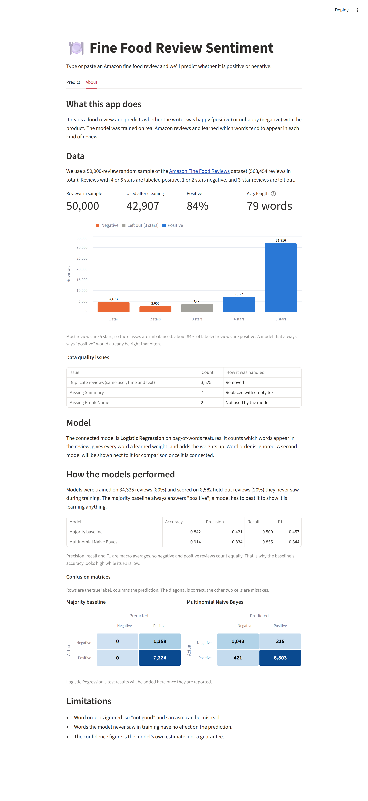

# Lamda: AI-Powered Text Intelligence Platform

Sentiment analysis of Amazon Fine Food Reviews, from data to a deployed app.

CSE 3521: Survey of Artificial Intelligence I | Autumn 2026 | Flagship Group Project

## Team Members

- Landon
- Maanav Jajodia
- Irene
- Supra
- Yonal

## Project Description

Lamda is a text intelligence system that predicts the sentiment of Amazon food reviews. The team works from a shared sample of 50,000 reviews drawn from the [Amazon Fine Food Reviews](https://www.kaggle.com/datasets/snap/amazon-fine-food-reviews) dataset (568,454 reviews with text, 1–5 star ratings, timestamps, and helpfulness votes). Review text and summaries are the inputs. Star ratings are mapped to a sentiment label the team chooses, such as positive/negative or a three-class scheme.

The comparison uses bag-of-words counts for Multinomial Naive Bayes and Logistic Regression, and trainable word embeddings for the LSTM. All three models are evaluated against a majority-class baseline on the same held-out reviews.

## How to Run

Use Python 3.13, the version used for the comparison. Run all commands from the repository root.

1. **Create and activate a virtual environment**

   ```bash
   python -m venv .venv
   # Windows
   .venv\Scripts\activate
   # macOS/Linux
   source .venv/bin/activate
   ```

2. **Install dependencies**

   ```bash
   python -m pip install -r requirements.txt
   ```

3. **Trained models.** The app loads the three models Maanav exported to `models/` (`logistic_regression.joblib`, `naive_bayes.joblib`, `lstm.pt`) and their test results from `models/comparison_metrics.json`. These files are committed, so no extra step is needed. To retrain them, see [Reproduce the model comparison](#reproduce-the-model-comparison).

4. **Launch the app**

   ```bash
   streamlit run app.py
   ```

   Streamlit opens the app in your browser (default http://localhost:8501). Type a review and click **Predict sentiment** to see all three models' predictions.

## Reproduce the model comparison

1. Set up the virtual environment and install the pinned dependencies above. The recorded run used the CPU build of PyTorch.
2. Put `Reviews.csv` in `data/`. If the file is absent, the training script uses KaggleHub to download dataset version 2. To provide a CSV at a different path, pass `--reviews path/to/Reviews.csv`. [Amazon Fine Food Reviews](https://www.kaggle.com/datasets/snap/amazon-fine-food-reviews)
3. Train and evaluate all three models with `python -m src.train`. The default run uses four CPU threads, at most 12 LSTM epochs, and early stopping after three epochs without improvement in validation macro F1.

The command writes fitted Naive Bayes and Logistic Regression pipelines, an LSTM checkpoint, the loss curve, and full-precision metrics to `models/`. Use `--models-dir` to write the outputs to another directory. The comparison summarizes held-out scores, confusion matrices, and model settings. [Model comparison](ml_engineer_model_comparison.md) · [Run metrics](models/comparison_metrics.json)

For inference, call `load_predictor` from `src.predict` with `"logistic_regression"`, `"naive_bayes"`, or `"lstm"`. The returned function accepts a review and an optional summary and returns `0` for negative or `1` for positive.

## Streamlit App

The front end is a Streamlit app defined in [app.py](app.py). It has two tabs: **Predict**, which opens first, and **About**. To run it locally, follow [How to Run](#how-to-run) above; the last step is `streamlit run app.py`.

| File | Purpose |
| --- | --- |
| [app.py](app.py) | Page layout and the two tabs |
| [app_models.py](app_models.py) | Connects the app to the trained models. Labels come from `load_predictor` in [src/predict.py](src/predict.py); the confidence comes from each model's probability of "positive" |
| [app_charts.py](app_charts.py) | The star rating chart and confusion matrices on the About tab |
| [app_data.py](app_data.py) | The dataset summary figures on the About tab, copied from the notebook's Milestone 1 outputs, since the dataset CSVs are not committed |

Model results on the About tab are read from [models/comparison_metrics.json](models/comparison_metrics.json), so they update whenever the models are retrained with `python -m src.train`.

### Deployment

The app is not deployed yet, so there is no live URL. The planned target is Streamlit Community Cloud, pointed at `app.py` on the `main` branch of this repository. The URL will be added here once the app is live.

### Tab 1: Predict

This tab takes one review and shows all three models' predictions side by side.

| Element | What it shows | How the user interacts |
| --- | --- | --- |
| Example buttons | **Positive**, **Negative**, **Mixed** and **Negation** examples | Click one to fill the review box with a ready-made review |
| **Your review** text area | The review to classify | Type or paste a review, or edit an example |
| **Predict sentiment** button | The primary action | Click to run all three models on the text in the box |
| One column per model | Logistic Regression, Multinomial Naive Bayes and LSTM: each shows a green Positive or red Negative label and the model's confidence | Read only |
| Influential words table | For the two bag-of-words models, the five words in the review that moved the prediction most, and which way. The LSTM reads words in order, so it has no per-word breakdown | Read only |
| Agreement note | Whether the three models agree or disagree | Read only |

**Typical use**

1. Click an example button, or type or paste a review into **Your review**.
2. Click **Predict sentiment**.
3. Compare the three columns: the label, the confidence, and the words behind each bag-of-words prediction.
4. To try another review, change the text and click the button again.



*A clearly negative review: all three models agree.*



*The negation example: the bag-of-words models count "good", "great" and "fresh" as positive, while the LSTM, which reads word order, correctly predicts Negative.*

If the box is empty or contains only spaces when the button is clicked, the app shows a "Please enter a review first." warning and makes no prediction.

### Tab 2: About

This tab explains the project to a non-technical reader and summarizes the data and results. Hover over a bar or matrix cell for exact values; there is nothing else to click.

| Section | What it shows |
| --- | --- |
| **What this app does** | A one-paragraph explanation |
| **Data** | The dataset source and labeling rule; headline figures (50,000 reviews sampled, 42,907 used after cleaning, 84% positive, 79 words on average); a chart of reviews per star rating colored by label; and a table of data quality issues and how each was handled |
| **Models** | How each of the three models makes its prediction, in plain language |
| **How the models performed** | The training, validation and test split sizes; a table of accuracy, precision, recall, F1 (macro averages) and training time for each model and the majority-class baseline; a confusion matrix per model; and the LSTM's training and validation loss curve |
| **Limitations** | Where the models can go wrong |



*The About tab.*
