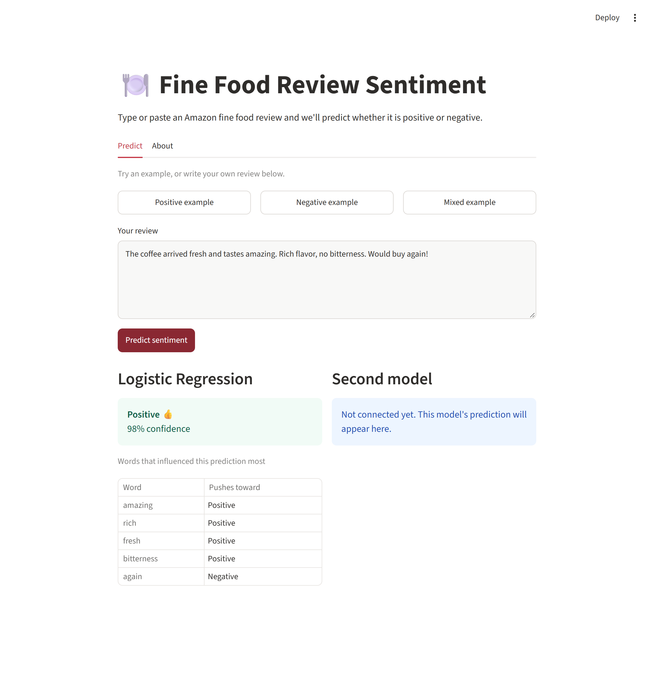

# Lamda: AI-Powered Text Intelligence Platform

Sentiment analysis of Amazon Fine Food Reviews, from data to a deployed app.

CSE 3521: Survey of Artificial Intelligence I | Autumn 2026 | Flagship Group Project

## Team Members

- Landon
- Maanav Jajodia
- Irene
- Supra
- Yonal

## Project Description

Lamda is a text intelligence system that predicts the sentiment of Amazon food reviews. The team works from a shared sample of 50,000 reviews drawn from the [Amazon Fine Food Reviews](https://www.kaggle.com/datasets/snap/amazon-fine-food-reviews) dataset (568,454 reviews with text, 1–5 star ratings, timestamps, and helpfulness votes). Review text and summaries are the inputs. Star ratings are mapped to a sentiment label the team chooses, such as positive/negative or a three-class scheme.

The system has three layers. Raw reviews are converted into at least two numerical feature representations (for example, bag-of-words, TF-IDF, word embeddings, or character n-grams). 

 We use Naive Bayes and Logistic Regression our classical models to create a baseline. Then we train LSTM compare against those baselines.

## How to Run

Requires Python 3.10+. Run all commands from the repository root.

1. **Create and activate a virtual environment**

   ```bash
   python -m venv .venv
   # Windows
   .venv\Scripts\activate
   # macOS/Linux
   source .venv/bin/activate
   ```

2. **Install dependencies**

   ```bash
   pip install -r requirements.txt
   ```

3. **Get the trained model.** The app loads `sentiment.joblib` from `models/` (or `notebooks/models/`). If it is missing, run all cells in [notebooks/1_data_clean.ipynb](notebooks/1_data_clean.ipynb); the last cell trains the model and saves it.

4. **Launch the app**

   ```bash
   streamlit run app.py
   ```

   Streamlit opens the app in your browser (default http://localhost:8501). Type a review and click **Predict sentiment**.

## Streamlit App

The front end is a Streamlit app defined in [app.py](app.py). It has two tabs: **Predict**, which opens first, and **About**. To run it locally, follow [How to Run](#how-to-run) above; the last step is `streamlit run app.py`.

| File | Purpose |
| --- | --- |
| [app.py](app.py) | Page layout and the two tabs |
| [app_charts.py](app_charts.py) | The star rating chart and confusion matrices on the About tab |
| [app_data.py](app_data.py) | The dataset and model numbers the About tab displays, copied from the notebook's outputs. The dataset CSVs are not committed, so the app cannot compute them itself. Update this file when new results are reported. |

### Deployment

The app is not deployed yet, so there is no live URL. The planned target is Streamlit Community Cloud, pointed at `app.py` on the `main` branch of this repository. The URL will be added here once the app is live.

### Tab 1: Predict

This tab takes one review and shows each model's prediction in its own column.

| Element | What it shows | How the user interacts |
| --- | --- | --- |
| Example buttons | **Positive example**, **Negative example**, **Mixed example** | Click one to fill the review box with a ready-made review |
| **Your review** text area | The review to classify | Type or paste a review, or edit an example |
| **Predict sentiment** button | The primary action | Click to run the prediction on the text in the box |
| **Logistic Regression** column | The label (green Positive or red Negative) and the model's confidence | Read only |
| Influential words table | The five words in the review that moved the prediction most, and which way | Read only |
| **Second model** column | A "Not connected yet" note | Reserved for the second trained model, so the two predictions will sit side by side |

**Typical use**

1. Click an example button, or type or paste a review into **Your review**.
2. Click **Predict sentiment**.
3. Read the label, the confidence, and the words behind the prediction.
4. To try another review, change the text and click the button again.


*A negative review: the prediction, the words that drove it, and the column reserved for the second model.*



*A positive review.*

If the box is empty or contains only spaces when the button is clicked, the app shows a "Please enter a review first." warning and makes no prediction.

### Tab 2: About

This tab explains the project to a non-technical reader and summarizes the data and results. Hover over a bar or matrix cell for exact values; there is nothing else to click.

| Section | What it shows |
| --- | --- |
| **What this app does** | A one-paragraph explanation |
| **Data** | The dataset source and labeling rule; headline figures (50,000 reviews sampled, 42,907 used after cleaning, 84% positive, 79 words on average); a chart of reviews per star rating colored by label; and a table of data quality issues and how each was handled |
| **Model** | How the connected Logistic Regression model works |
| **How the models performed** | The 80/20 train/test split, a table of accuracy, precision, recall and F1 on the test set (macro averages) for each model against the majority-class baseline, and a confusion matrix per model |
| **Limitations** | Where the model can go wrong |

The results section currently shows the majority baseline and Multinomial Naive Bayes, the results reported in the notebook so far. Further models appear automatically once their results are added to [app_data.py](app_data.py).


*The About tab.*

### Current limitations

- One model (Logistic Regression) is connected on the Predict tab. The second-model column is a placeholder until that model is delivered.
- The results section does not yet include Logistic Regression's test results, because they have not been reported yet.
- The model uses bag-of-words features, so negation ("not good") and sarcasm can be misclassified.
