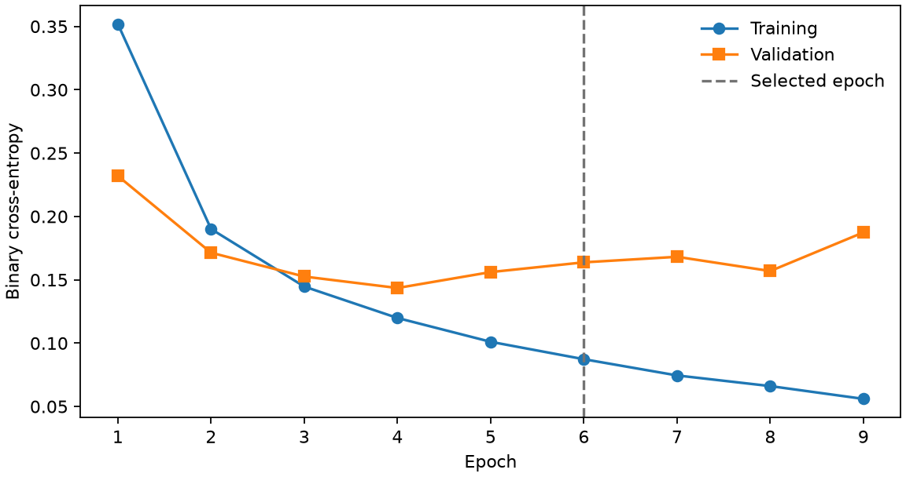

# ML Engineer Model Comparison

## Work completed

The project notebook establishes the shared training and test split and the classical baselines. The comparison script tunes and evaluates both classical models, trains and evaluates the LSTM, and exports the three fitted models for inference. The app engineer owns the Streamlit integration and deployment. [Project notebook](notebooks/1_data_clean.ipynb) · [Course project brief, pp. 2, 3, and 5](group_project.pdf)

## Evaluation setup

- From the seed-45 sample of 50,000 Amazon Fine Food Reviews, removing 3-star reviews and duplicates by user ID, timestamp, and review body leaves 42,907 reviews. Scores 1–2 are negative and 4–5 are positive. Inputs combine the review summary and body with HTML tags stripped. [Dataset](https://www.kaggle.com/datasets/snap/amazon-fine-food-reviews) · [Preprocessing code](src/preprocessing.py)
- All models use the notebook's stratified 20% held-out split of 8,582 reviews, with 1,358 negative and 7,224 positive. The development split supplies 30,892 fitting reviews and 3,433 validation reviews. Feature vocabularies are fitted on the fitting reviews. Validation macro F1 selects classical hyperparameters and the LSTM checkpoint. The older Milestone 2 write-ups use seed 42 and report a separate experiment. [Scoring code](src/evaluate.py) · [Training code](src/train.py) · [Earlier evaluation](held_out_test_evaluation.md)
- Precision, recall, and F1 are macro averages across both labels. Macro F1 is the ranking metric because it gives equal weight to the two labels, while 84.18% of the held-out reviews are positive.
- Training time is wall-clock time in seconds on one Intel Core Ultra 9 288V CPU with a four-thread limit. Classical times cover the selected estimator's fit. LSTM time covers all training epochs and their validation passes through early stopping or the epoch cap. Feature preparation, other classical tuning trials, test scoring, and artifact writing are outside the timed intervals.

Both classical models use bag-of-words counts over 10,979 terms, retaining terms that appear in at least five fitting reviews. The search selected smoothing `alpha=0.5` for Naive Bayes and inverse regularization strength `C=0.5` for Logistic Regression. The LSTM learns a dense embedding for each token in its own fitting-set vocabulary of 14,998 terms, with two additional entries for padding and unknown tokens.

## Held-out test results

| Model | Accuracy | Macro precision | Macro recall | Macro F1 | Training time (s) |
| --- | ---: | ---: | ---: | ---: | ---: |
| Majority-class baseline | 0.8418 | 0.4209 | 0.5000 | 0.4570 | 0.0019 |
| Multinomial Naive Bayes | 0.9142 | 0.8343 | 0.8540 | 0.8437 | 0.0107 |
| Logistic Regression | 0.9322 | 0.8877 | 0.8476 | 0.8659 | 2.3468 |
| LSTM | **0.9406** | **0.8967** | **0.8750** | **0.8854** | 316.2166 |

The LSTM ranked first on held-out macro F1, by 1.95 percentage points over Logistic Regression. It correctly classified 75 more negative reviews and three fewer positive reviews than Logistic Regression, for 72 more correct predictions overall. Logistic Regression had the highest macro F1 among the classical models. [Full-precision metrics](models/comparison_metrics.json)

### Confusion matrices

Each row reports the four cells of one model's confusion matrix on the same 8,582 reviews.

| Model | Actual negative, predicted negative | Actual negative, predicted positive | Actual positive, predicted negative | Actual positive, predicted positive |
| --- | ---: | ---: | ---: | ---: |
| Majority-class baseline | 0 | 1,358 | 0 | 7,224 |
| Multinomial Naive Bayes | 1,040 | 318 | 418 | 6,806 |
| Logistic Regression | 983 | 375 | 207 | 7,017 |
| LSTM | 1,058 | 300 | 210 | 7,014 |

## LSTM design

The LSTM maps ordered tokens to trainable 64-dimensional embeddings and runs one recurrent layer with 48 hidden units. A mean over the valid token states feeds a binary classifier. The first 128 tokens from each combined summary and review enter the model. The recurrent state can carry context across tokens, which gives it a way to distinguish a phrase such as “not good” from a positive use of “good.” Reviews beyond the token limit can lose evidence near the end. Training uses Adam, binary cross-entropy, dropout, and a validation-macro-F1 checkpoint. [LSTM implementation](src/lstm.py)

Training loss fell from 0.3519 in epoch 1 to 0.0560 in epoch 9. Validation loss reached its minimum of 0.1435 in epoch 4 and ended at 0.1874. Epoch 6 supplied the exported checkpoint because it had the highest validation macro F1 of 0.9084. Training stopped after three more epochs without an improvement in that metric. [Epoch history](models/comparison_metrics.json)

## Reproduction and app handoff

Run `python -m src.train` from the repository root after installing the pinned dependencies. The script reads the local `data/Reviews.csv` or downloads version 2 from Kaggle. The full-precision results include split fingerprints, selected hyperparameters, and epoch history. [Setup instructions](README.md#reproduce-the-model-comparison) · [Run results](models/comparison_metrics.json)

The app engineer can use `load_predictor("logistic_regression")`, `load_predictor("naive_bayes")`, or `load_predictor("lstm")` from `src.predict`. Each returns a function that accepts review text and an optional summary and returns `0` for negative or `1` for positive. [Inference code](src/predict.py)

Use these measured results to write your own interpretation for the course report and disclose AI implementation assistance as required by the course brief. [Course project brief, p. 9](group_project.pdf)
